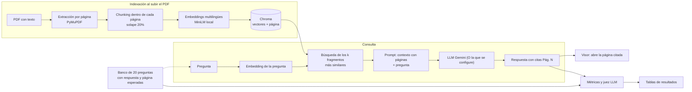
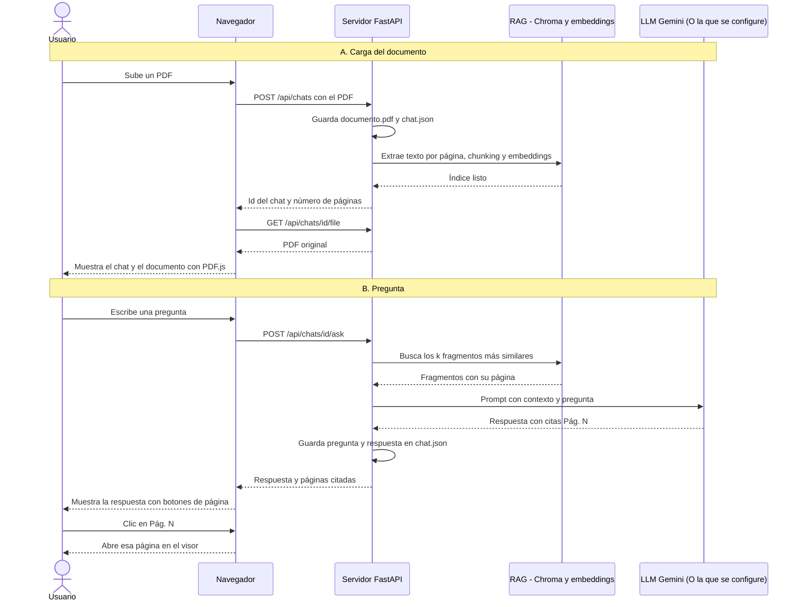

# Nexora: chatbot RAG que responde con páginas citadas

**Autor:** Andres David Osorio Moreno y Juan Esteban Jimenez Cardona· **Curso:** Introducción a Inteligencia Artificial · **Fecha:** Noviembre de 2026

Nexora es una aplicación web local donde se sube un PDF con texto, se le hacen preguntas y cada respuesta indica la página de donde sale la información. Al hacer clic en la cita, el visor abre esa página del documento.

## 1. Introducción

Consultar reglamentos y documentos largos es lento y la gente tiende a no leerlos completos. Un modelo de lenguaje general puede responder con soltura, pero inventa datos cuando no conoce el documento: cifras, plazos o correos que parecen reales y no lo son.

Este proyecto implementa un sistema de generación aumentada por recuperación (RAG): antes de responder, busca en el documento los fragmentos más relevantes y obliga al modelo a contestar solo con ellos, citando la página. Aporta una aplicación completa (carga del PDF, chat, visor con zoom e historial) y una evaluación que mide, contra una línea base sin RAG, cuánto mejora la exactitud y cuánto baja la alucinación.

## 2. Objetivo

**General:** Construir y evaluar un chatbot RAG que responda preguntas sobre un PDF citando las páginas de origen.

**Específicos:**
1. Implementar el pipeline completo (indexación, recuperación y respuesta con citas de página) con una interfaz web que muestre el documento.
2. Alcanzar al menos 70% de respuestas correctas en las preguntas que sí tienen respuesta en el documento, comparando 6 configuraciones (chunk de 400, 800 y 1500 caracteres × 3 y 5 fragmentos recuperados) contra una línea base sin RAG.
3. Lograr 0% de alucinaciones y rechazar correctamente las preguntas cuya respuesta no está en el documento.

## 3. Datos

- **Documento:** Reglamento académico de pregrado de la Universidad EAFIT, en PDF con texto. Fuente: https://www.eafit.edu.co/institucional/reglamentos/reglamento-academico-de-los-programas-de-pregrado, descargado en Noviembre de 2026.
- **Banco de evaluación:** 20 preguntas escritas y anotadas a mano por el autor, cada una con su respuesta esperada y la página donde está (`eval/preguntas.txt`).

| Tipo de pregunta | Cantidad | Ejemplo |
|---|---|---|
| Directas | 10 | ¿A cuántas horas de trabajo académico equivale un crédito? |
| Relacionar información (dos partes) | 6 | Si un estudiante tiene matrícula condicional, ¿puede cancelar asignaturas y qué promedio debe alcanzar? |
| Sin respuesta en el documento | 4 | ¿Cuánto cuesta la matrícula de Ingeniería de Sistemas en 2027-1? |

| Dato del documento | Valor |
|---|---|
| Páginas | 75 |

**Preprocesamiento:** El texto se extrae página por página (PyMuPDF), se normalizan los espacios y se parte en fragmentos *dentro* de cada página, con solape del 20%. Así ningún fragmento cruza páginas y cada uno conserva su número de página exacto.

**Limitaciones y sesgos:** Un solo documento; solo PDF con texto (sin OCR, un PDF escaneado se rechaza con aviso); el banco es pequeño y lo escribió quien desarrolló el sistema, por lo que puede favorecerlo. **Licencia:** el reglamento es propiedad de la universidad y se usa con fines académicos. El documento se incluye en el repositorio, en `data/reglamento.pdf`

## 4. Metodología

1. **Indexación:** Extracción por página, chunking, embeddings con `paraphrase-multilingual-MiniLM-L12-v2` (local, funciona bien en español) y almacenamiento en Chroma con la página como metadato.
2. **Recuperación:** Búsqueda por similitud coseno de los *k* fragmentos más cercanos a la pregunta.
3. **Generación:** Los fragmentos recuperados y sus páginas se pasan a Gemini (plan gratuito de Google AI Studio, modelo `[gemini-3.5-flash-lite]`, temperatura 0,2, se ouede configurar desde el `.env`). El prompt exige responder solo con el contexto, decir "No encontré esa información en el documento" si no está, y citar `[Pág. N]`.
4. **Evaluación:** 7 configuraciones sobre las 20 preguntas (línea base + 6 de RAG). Se descartó un modelo más grande o un reranker por tiempo y por el límite del plan gratuito.
5. **Despliegue:** Servidor FastAPI local que sirve la interfaz web (HTML/CSS/JS con PDF.js).

**Justificación:** El chunking por página permite citar con exactitud; los chunks de 400, 800 y 1500 caracteres y los *k* de 3 y 5 cubren desde fragmentos muy específicos hasta muy amplios; la línea base (el mismo modelo sin documento) aísla el aporte de la recuperación.

**Métricas:**
- *Recuperación:* La página esperada está entre las de los *k* fragmentos (mide páginas, no fragmentos).
- *Pág. citada:* La página esperada aparece en las citas de la respuesta.
- *Exactitud:* La respuesta contiene la información esencial de la esperada. La califica un LLM como juez, comparando contra la respuesta esperada.
- *Falso rechazo:* Dice "No encontré" cuando la respuesta sí estaba en el documento.
- *Rechazo correcto:* Dice "No encontré" cuando no estaba.
- *Alucinación:* Afirma datos que contradicen la referencia o parecen inventados.


*Figura 1. Flujo metodológico, desde el PDF y las preguntas hasta las métricas.*

## 5. Diagrama de interacción


*Figura 2. Secuencia de la aplicación en uso: carga del documento (A) y consulta (B).*

## 6. Resultados

Banco de 20 preguntas: 16 con respuesta en el documento (10 directas y 6 de relacionar información) y 4 sin respuesta.

| Configuración | Recuperación (de 16) | Pág. citada (de 16) | Directas (de 10) | Relacionar (de 6) | Falsos rechazos (de 16) | Rechazo correcto (de 4) | Alucinación (de 20) |
|---|---|---|---|---|---|---|---|
| Línea base (sin RAG) | — | — | 2 | 1 | — | 2 | 11 (55%) |
| RAG chunk 400, k=3 | 15 (94%) | 10 (62%) | 9 | 2 | 5 | 4 | 0 |
| **RAG chunk 400, k=5** | **16 (100%)** | **11 (69%)** | **10** | **2** | **4** | **4** | **0** |
| RAG chunk 800, k=3 | 15 (94%) | 10 (62%) | 8 | 2 | 6 | 4 | 0 |
| RAG chunk 800, k=5 | 15 (94%) | 11 (69%) | 8 | 2 | 5 | 4 | 0 |
| RAG chunk 1500, k=3 | 11 (69%) | 8 (50%) | 6 | 2 | 7 | 4 | 0 |
| RAG chunk 1500, k=5 | 13 (81%) | 8 (50%) | 7 | 2 | 6 | 4 | 0 |

*Tabla 1. Resultados por configuración. La configuración elegida (400 caracteres, k=5) está en negrita. Detalle de cada respuesta: `eval/resultados/detalle.csv`.*

**Qué funcionó**
- El RAG responde bien 12 de las 16 preguntas con respuesta (75%) contra 3 de la línea base (19%), y cumple el objetivo del 70%.
- Elimina las alucinaciones: El juez automático no detectó ninguna alucinación (0 de 20) frente a 11 de 20 en la línea base
- Rechaza correctamente las 4 preguntas sin respuesta (la línea base solo 2).
- Los fragmentos pequeños funcionan mejor: con k=5 la exactitud en directas va de 10 de 10 (400) a 8 (800) y 7 (1500), y con k=5 la exactitud en directas es igual o mayor que con k=3 en los tres tamaños (empatan con chunk 800), y la recuperación también.

**Qué no funcionó**
- Las preguntas de relacionar información se quedan en 2 de 6 en todas las configuraciones. En la elegida, las 4 que fallan (reingreso, tercera pérdida de una asignatura, homologación y matrícula condicional) son **falsos rechazos**: el sistema dice "No encontré esa información" aunque la página correcta sí estaba entre las recuperadas. Todas son preguntas de dos partes. Una explicación probable, no verificada, es que el prompt estricto rechaza todo cuando solo llega una parte de la información entre los *k* fragmentos.

**Limitaciones**
- Con 16 preguntas con respuesta, una sola pregunta pesa 6 puntos porcentuales: las diferencias de una o dos preguntas entre configuraciones son tendencias y no resultados concluyentes.
- La exactitud la califica el mismo modelo que responde, así que no es un juez independiente. Se revisó manualmente una muestra de 100 respuestas y hubo acuerdo en 98, siendo estas por equivocacion en el banco de preguntas que hicieron que el juez fallara (Este error ya fue corregido).
- La métrica de recuperación mide páginas, no si el fragmento exacto con la respuesta llegó, y puede sobrestimar la recuperación.
- Al revisar los fallos se corrigieron dos páginas del banco que estaban mal anotadas (el RAG tenía razón), y las métricas de página de esta tabla ya incluyen esa corrección.
- Un único documento, solo PDF con texto, y el plan gratuito de Gemini limita la cantidad de pruebas.
- **Trabajo futuro (no evaluado):** recuperar más fragmentos (k=8) y un prompt que responda por partes e indique cuál falta, para atacar los falsos rechazos.

## 7. Reproducibilidad

**Requisitos:** Python 3.10 o superior (probado en 3.13), una llave gratuita de Google AI Studio y conexión a internet para la API. En la primera ejecución se descarga el modelo de embeddings (unos 120 MB).

```powershell
git clone https://github.com/Nacho-024A/Proyecto_RAG
cd proyecto_rag
python -m venv .venv
.venv\Scripts\Activate.ps1
pip install -r requirements.txt
copy .env.example .env      # y pega tu IA_API_KEY y el LLM_MODEL dentro de .env
python server.py            # abre http://127.0.0.1:8000
```

**Evaluación** (pon el PDF en `data/reglamento.pdf`):

```powershell
python eval/run_eval.py --juez     # corre las configuraciones y las califica
python eval/resumen.py             # genera eval/resultados/resumen.md y detalle.csv
```

Si se agota la cuota de la API, vuelve a ejecutar el mismo comando: continúa donde se quedó.

**Estructura del repositorio**

```
proyecto_rag/
├── server.py            # API FastAPI y servidor de la interfaz
├── cli.py               # prueba por consola
├── src/
│   ├── ingest.py        # lectura del PDF por página y chunking
│   ├── rag.py           # embeddings, Chroma, recuperación y respuesta
│   └── llm.py           # conexión con la IA
├── web/                 # interfaz (HTML, CSS, JS) y PDF.js en vendor/
├── eval/
│   ├── preguntas.txt    # banco de 20 preguntas
│   ├── run_eval.py      # corre y califica las configuraciones
│   ├── resumen.py       # tablas de resultados
│   └── resultados/      # raw.jsonl, resumen.md, detalle.csv
├── data/                # reglamento.pdf (data/chats/ se genera y no se versiona)
├── requirements.txt
└── .env.example
```

### Licencias

- **Código del proyecto:** MIT License.
- **PDF.js:** Apache License 2.0 (Mozilla), ubicado en `web/vendor/pdfjs/`.

Las dependencias de terceros conservan sus respectivas licencias y avisos de copyright.
